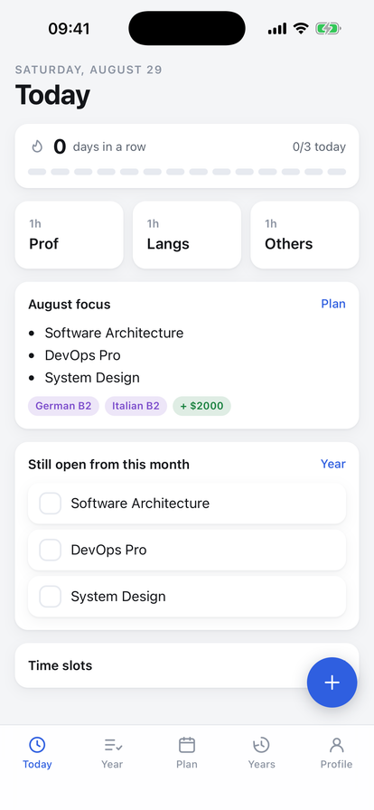

# GoalsTable

Product page: https://mrwd.github.io/products/goals-table/ · iOS beta: https://testflight.apple.com/join/EbV3NMrK



A yearly goals tracker, built from a Google Sheet that had been kept since 2020.

One codebase runs on the web, on desktop, on Android and on iPhone. Everything lives on
the device: no account, no server, no analytics.

The fourth of the local-first trackers, after [FilmTable](https://github.com/mrWD/film-table),
[GamesTable](https://github.com/mrWD/games-table) and [BooksTable](https://github.com/mrWD/books-table),
and it shares their storage layer through [tables-core](https://github.com/mrWD/tables-core).

## What it does

The spreadsheet had three separate things in it, and the app keeps them separate:

| Screen | The part of the sheet it replaces |
|---|---|
| **Today** | the `1h : Prof / 1h : Langs / 1h : Others` cells and the time column |
| **Year** | the `Expected Results 2026` column, still being filled in |
| **Plan** | the twelve month blocks — focus, money target, language level |
| **Years** | `Results 2025` back to `Results 2020`, plus the `Backlog` column |
| **Profile** | the resources list, and getting the data back out — plus the author's other projects and the donation links |

What the sheet could not do, and this does:

- **A tick is one tap**, on a phone, without opening a spreadsheet.
- **Progress is visible**: a ring per year, a bar per category, before any row is read.
- **Search across every year at once** — "when did I do Docker?" was the question the
  sheet was worst at.
- **Streaks** over the three daily hours, with the last fortnight as a strip of dots.
- **The backlog is a place to move things out of**, not a column to retype them from.
- **It works with no network**, which is where a phone usually reads it.

## Languages

Twenty interface languages: Arabic, Bulgarian, Czech, German, English, Spanish, French,
Hindi, Indonesian, Italian, Japanese, Korean, Dutch, Polish, Portuguese, Russian, Serbian,
Turkish, Ukrainian, Chinese. The list follows the one in AI Job Search and adds the four
languages left over from the owner's own backlog (Dutch, Czech, Serbian, Bulgarian) plus
Korean and Indonesian.

The picker is in Profile, and defaults to the system language — `navigator.languages` in
the user's own order of preference, so someone whose list is `[sv, de, en]` gets German
rather than English.

- **Locales load on demand**, one chunk each (`src/i18n/locales/<code>.ts`), so twenty
  languages cost ~13 KB in the main bundle rather than 104 KB. Every chunk is precached by
  the service worker and shipped inside the native app, so switching language works offline.
- **Plurals go through `Intl.PluralRules`** — a locale supplies only the forms its language
  needs. Russian and Polish get `one/few/many`, Arabic can use all six, Japanese one.
- **Dates, month names and amounts come from `Intl`**, not from lists — twelve month names
  in twenty languages is 240 strings the platform already has, declined correctly.
- **Arabic is right-to-left.** The app sets `dir="rtl"`, and the stylesheet uses logical
  properties so the whole layout mirrors, rail included.

Not translated, on purpose: goal titles, month focus text, the routine block labels
(Prof / Langs / Others) and resource names — that is the owner's own data. Nor the ten
project taglines in "More from the author", which describe English-language products.

## Categories

Seven years of rows arrived as bare strings, so the category is inferred from the title
(`src/lib/categorize.ts`) into Tech / Languages / Money / Health / Life / Projects. The
order of those tests matters — "AI Lang Tutor" is a project rather than a language, and
"German Taxes" is money rather than German. Any inference can be overridden per goal, and
an override survives a rename.

## Running it

```bash
npm install
npm run dev                       # :5173
npm run build && npm run preview  # :4173
```

For the store builds — use this before `npx cap sync`, never plain `build`. It ships no
service worker and destroys any already installed: inside the app every file is local
anyway, and the worker's only effect was to keep serving the previous build after an
update.

```bash
npm run build:native
npx cap sync
```

`node scripts/gen-icons.mjs` regenerates the PNG icons from `public/favicon.svg`.

## Platforms

| Platform | How | Status |
|---|---|---|
| Web | Vite build, any static host | builds |
| Desktop | the same PWA, installed from the browser — the layout switches to a rail and a 4×3 month grid above 900px | builds |
| Android | Capacitor 8 shell in `android/` | debug APK builds |
| iOS | Capacitor 8 shell in `ios/`, SPM rather than CocoaPods | builds and runs on the simulator |

There is no Electron or Tauri wrapper. On desktop the installable PWA is the app — if a
signed `.dmg`/`.exe` is ever wanted, that is the piece to add.

## The data

`src/lib/seed.ts` holds the spreadsheet as it stood on 2026-08-15: 306 goals across seven
years plus the backlog, the twelve month plans, the daily blocks, the time slots and the
resources list.

It is the **first run only**. Once anything is in device storage the seed is never read
again, so editing it does not change an app that is already installed.

Titles are verbatim, typos included ("Angluar", "Cloude", "Nederlanfish"). They are the
owner's own record and his to correct in the app.

One row was dropped: `Second Brain` appeared twice in the 2026 column, both ticked.
Duplicates are collapsed within a year but never across years — `React *` in both 2020 and
2021 is two separate facts.

## Storage

IndexedDB in a browser; a JSON file in private app storage inside the native shell, because
a WebView's IndexedDB is *site data* to the OS — iOS may reclaim it under storage pressure
and "Offload App" discards it. Seven years of ticked goals is not something to lose that
way. Both live behind `createDeviceStorage` from `tables-core`.

Export is a JSON backup or a CSV of the goals, from Profile. The CSV writes the tick as
`TRUE`/`FALSE` so Sheets reads it back as a checkbox.

## Licence

MIT.
